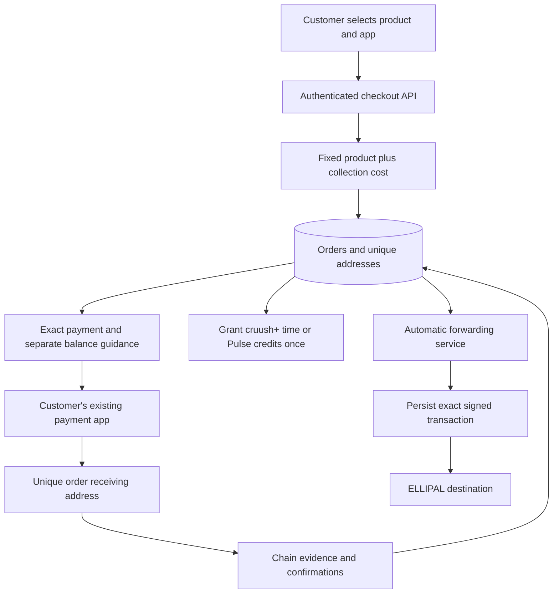

# cruush crypto processor: architecture

Version 2.0, September 12, 2026. This describes the actual implementation on `security/crypto-processor-review-20260908`, including native Bitcoin and automatic forwarding. See `CODEX_HANDOFF.md` for current validation and owner setup, and `docs/crypto-checkout-fees.md` for the catalog allowances. Earlier security-review documents describe the prior baseline; they do not certify the new signer.

## Components and money flow

1. The authenticated checkout API owns product prices, order identity, public address derivation and the fixed quote. PostgreSQL owns address allocation, observations, settlement and entitlements.
2. Chain observers read supported EVM networks or Bitcoin mainnet through Esplora. They verify recipient, amount, network, block identity, timing and confirmation depth before granting a purchase.
3. The separate forwarding service holds the processor receive-chain spending keys. It automatically signs and broadcasts transfers from paid receiving addresses into the owner's ELLIPAL destinations. The website never needs those keys or the ELLIPAL recovery words.

Acceptance and forwarding are distinct stages. The entitlement is granted when the deposit qualifies; forwarding follows automatically. Network or fee delays can defer forwarding without requiring a manual command for each address.

## Prices and the two checkout amounts

The API reads the existing catalog and accepts no browser-supplied price or entitlement. It stores a fixed product-plus-collection quote with metadata. Stablecoins use six decimal places; Bitcoin uses satoshis and an issuance-time BTC/USD conversion rounded upward. Later exchange-rate changes never rewrite that order's BTC obligation.

**Send exactly** is the product plus cruush's quoted collection cost. It is the amount in the payment URI/QR and the minimum required for fee-bearing settlement. **Have available** adds the estimated Cash App, PayPal or Venmo sending allowance. That allowance stays in the customer's app and is not subtracted from the exact recipient amount. Unused balance belongs to the customer. Other wallets get no sender allowance estimate.

The allowance policy takes the maximum of a $5 floor ($10 for Venmo/Ethereum), 10% of the product price rounded upward to whole dollars, and three times the quoted collection cost rounded upward to dollars. It is cruush's estimate, not a provider-authenticated quote or guaranteed maximum. Provider recipient minimums are checked separately; buying more cannot make an undersized exact payment eligible.

EVM collection estimates include token movement, a native gas-funding transfer and applicable network fee components. Bitcoin estimates reserve a 150-vbyte forwarding transaction at the current target-one-block fee rate. A normal receipt creates no separate recipient gas bill. The customer's outgoing app fee is separate from these collection costs.

Stablecoin forwarding requires a native ETH working balance on the selected chain. The service automatically supplies ETH to individual receiving addresses; stablecoin collection charges reimburse its estimated value. Bitcoin pays its forwarding fee from received BTC. No exchange/conversion or automatic ETH replenishment is implemented.

## Order identity and deadlines

Every order persists its owner, product, network, asset, address derivation index, wallet fingerprint, quote and publication deadline. Database allocation prevents reusing a receiving address for another order. EVM uses the existing public receive-chain descriptor; Bitcoin uses BIP84 at `m/84'/0'/0'/0` and native SegWit receiving addresses.

New orders default to a 24-hour on-chain arrival window. Previously issued deadlines remain unchanged. A payment included on-chain by the deadline can finish confirmation afterward. A customer app's pending status is not proof of on-chain arrival. Changing method cancels an unpaid order before a fresh order/address/deadline is created. Confirming orders cannot be canceled through that flow.

`/store` and `/store/pulse` use the same store component and processor. Product-specific APIs preserve subscription and Pulse accounting. Fixed-term subscriptions never auto-renew; Pulse credits are a one-time purchase. The requested cross-navigation also appears on the cruush+ information page. Group Pulse is outside scope.

## Observation, confirmation and settlement

| Rail | Network | Confirmation target |
| --- | --- | ---: |
| USDC / PYUSD | Arbitrum | 240 |
| PYUSD | Ethereum | 12 |
| USDC | Base | 30 |
| BTC | Bitcoin mainnet | 6 |
| Test USDC | Base Sepolia, test infrastructure only | 3 |

Existing EVM policy can require a higher target. Bitcoin's approved target is six. An hour is a rough Bitcoin block-production average, not a guaranteed time from clicking Send. The UI polls actual server observations and displays progress such as 1/6.

The EVM watcher validates successful token transfer evidence against chain, contract, recipient and canonical blocks. Native Bitcoin verifies mainnet genesis, recent canonical head, transaction outputs and block identity. Its order/user locks encompass observation and settlement so overlapping passes cannot overwrite newer evidence with stale results. Removed pre-settlement chain evidence is reconciled before granting.

Atomic integer sums determine whether enough qualifying money arrived. Progress reflects the outputs needed to cover the quote; a small additional output does not reset a fully funded payment's progress. Transactional entitlement accounting grants once under repeated or concurrent observation. Timely deposits remain recoverable during the watcher recovery window after expiry. Wrong network, late deposits and exceptional accounting states remain support cases rather than automatic valid purchases.

Bitcoin uses its own evidence table and watcher. Its internal chain discriminator never enters the EVM RPC watcher. Support reconciliation includes native transaction outputs and canonical confirmation counts.

## Automatic forwarding and custody

`tools/cruush-wallet` supplies `setup-forwarding` and `forward`. One-time private setup verifies the existing processor wallet fingerprint, derives EVM and Bitcoin receive-chain keys, validates the public Bitcoin cold destination and writes a new private file. It never asks for ELLIPAL spending keys. Public xpub configuration goes to the API; the private file belongs only to the forwarding service.

The service queries paid orders, verifies each derived address/fingerprint, and prepares a transfer to the pinned EVM or configured Bitcoin ELLIPAL destination. It refuses a plan above the customer's stored collection budget and retries later. Bitcoin verifies source transaction bytes, scripts, amounts, canonical blocks and six confirmations before signing one destination output. Unconfirmed dust does not block an already confirmed purchase. A highly fragmented deposit can require more fee than the original single-input estimate.

`crypto_payment_collections` persists exact signed bytes before submission. Restart reuses the same transaction rather than creating another payment. Advisory locks serialize each wallet/network's work. EVM receipt-aware retry preserves successful gas funding and stops later nonce allocation while an earlier signed operation is unresolved. Bitcoin checks for an existing transaction before broadcasting and records eventual confirmation.

The supplied Docker/Compose service runs the real implementation continuously with automatic restart, no public port, a read-only private-file mount and a non-root service user. The key file must be private and owned by that user. Generic diagnostic counts/errors avoid logging key material or raw provider responses.

## Trust and failure boundaries

The processor relies on its database, application, configured chain sources and price source. Public derivation protects spending keys from routine API exposure but does not prevent a compromised checkout server from substituting instructions. The separate signer is an online software signer for the processor wallet; the ELLIPAL destination remains cold. It is not hardware signing of the intermediate transfers.

Fees can rise after issuance, and custodian app fees are not derivable exactly from public network conditions. If forwarding costs exceed the stored budget, the service waits and retries. Missing native ETH also requires replenishing the working balance. Funds remain controlled by the processor keys while waiting. Addresses continue to exist after timers expire.

Database address history and private key backups are necessary for recovery. A child private key combined with relevant public derivation information can compromise non-hardened BIP32 ancestry. Six confirmations reduce competing-chain risk but do not make consumed entitlements reversible or guarantee consensus finality. No automatic refunds, asset conversion, late-deposit entitlement override or post-grant benefit reversal is introduced here.

## Verification and configuration

Server, client and wallet builds pass. Focused tests exercise both product settlements in PostgreSQL, concurrent grants, pre-settlement reorganization, expiry timing, actual transaction signing with public unfunded keys, destination validation and fee-budget waiting. Authenticated local UI checks use real mainnet fee sources and persist real unpaid orders. No mainnet payment or collection was broadcast in this session.

The owner explicitly deferred Bitcoin address/private provisioning until code completion. The full implementation is present; those values and the service's working balances are necessary runtime inputs. Follow `tools/cruush-wallet/AUTOMATIC_FORWARDING.md` for exact setup. The existing API enabled/watcher flags must be true in the intended service. This task has not changed production configuration or deployed the branch.
