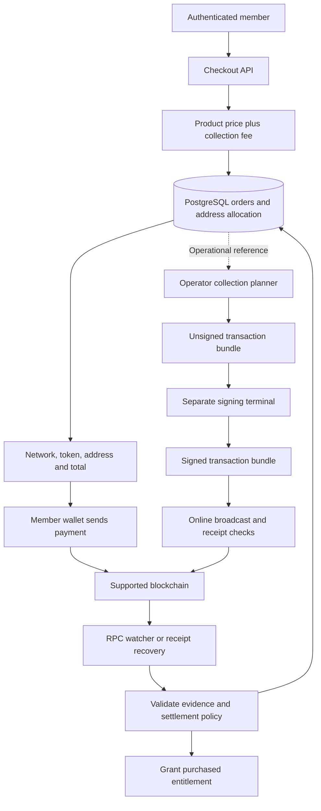

# cruush crypto processor: architecture and design rationale

Version 1.0 · 8 September 2026 · Security review draft

## Purpose and status

The processor lets an authenticated member purchase cruush products by transferring a supported stablecoin to an order-specific blockchain address. A backend verifies payment evidence, records settlement, and grants the purchased entitlement. A separate operator wallet collects deposited tokens.

This paper describes the implementation in `security/crypto-processor-review-20260908`. It explains the engineering rationale and tradeoffs of the existing design; it is not a security certification or a promise of launch readiness. Read [SECURITY_REVIEW.md](SECURITY_REVIEW.md) for validation evidence and release blockers, and [THREAT_MODEL.md](THREAT_MODEL.md) for adversaries, trust assumptions and residual risks.

The processor is disabled by default. Testnet transfers have exercised parts of the wallet workflow, and local tests have exercised fee-inclusive settlement and concurrency. Those are separate evidence sets. A complete live payment rehearsal using the new mandatory fee remains outstanding.

## System structure

The implementation has three operational parts:

1. **Checkout and accounting service.** The existing authenticated application owns product selection, prices, order identity, allocated addresses and entitlement records. PostgreSQL provides durable state and transactions.
2. **Chain observer.** RPC clients retrieve transfer evidence and block information. The watcher and receipt recovery path apply settlement policy before crediting an order.
3. **Operator wallet.** A separate command-line tool derives spending keys, validates plans, signs transactions and broadcasts signed bundles. The application server receives public derivation information, not recovery words.

The dashed connection represents information needed by operations, not an implemented automatic server-to-signer integration. Payment acceptance and collection are distinct: the entitlement can be granted when the deposit qualifies, before the operator consolidates tokens.

## Purchase lifecycle

### 1. Create an authenticated order

The member selects a supported product and payment rail. The server determines the price and binds the intent to the authenticated member. It does not accept a browser-supplied entitlement or price as authoritative.

The order workflow uses database transactions, reservations and idempotency handling to prevent retries from allocating inconsistent purchases. Product accounting includes subscription entitlements and purchased pack credits; the presence of pack accounting does not add a separate group product or group interface.

The principal implementation is `server/src/crypto-payments.ts`, reached through `server/src/routes/crypto-payments.ts`. Direct billing integration is in `billing.ts` and `ping-packs.ts`.

### 2. Calculate and persist the mandatory collection fee

A new order includes the product price plus a mandatory estimate of the cost of collecting its tokens. The fee is denominated in the purchase stablecoin. It is part of the amount that must reach the deposit address.

The estimator reads the selected chain's gas conditions, simulates token and native transfers, adds gas allowances, and converts the estimated ETH cost using Coinbase's public ETH/USD spot response. Base estimates also include Layer 1 data and operator fee reserves. The result is rounded upward to cents and stored with its estimation metadata.

The stored quote is fixed for the addressed order. Reopening an order reuses that quote rather than silently changing what the member owes. A failed fee lookup prevents successful order issuance and rolls back the reservation. A freshness check runs after the price fetch so a slow fetch cannot leave an already-stale block sample accepted.

The fee is an estimate, not reimbursement of a measured future transaction. The implementation does not refund an unused estimate or bill a later difference automatically. The purchaser also pays their sending wallet's network fee. Collecting stablecoin does not create native ETH: the operator still needs ETH to fund and execute collection transactions.

The design prices supported stablecoin atomic amounts against a dollar-denominated product catalog. Stablecoin depegging is therefore a commercial risk, not something this ETH/USD conversion resolves. Estimation allowances, the fee cap, source availability and collection delay need launch review.

### 3. Publish a unique deposit address

The server derives a child address from an extended public key and persists its association with the order. The member receives the network, asset, address and quoted total. An address on one EVM chain does not establish that a payment on another chain qualifies.

Unique addresses make order attribution possible without asking each member to add a memo to an ERC-20 transfer. They also create operational costs: each address holding tokens may require native gas before those tokens can be collected.

The public descriptor enables address derivation without putting routine spending keys on the application server. It remains sensitive operational data because it can expose relationships among derived addresses. Database allocation history must survive recovery so old addresses are not reassigned to new orders.

### 4. Observe and validate the transfer

The watcher reads chain evidence through configured RPC endpoints. The receipt recovery path provides another way to inspect a known transaction. Neither a transaction hash supplied by a client nor a successful HTTP response alone proves a purchase was paid.

Validation binds evidence to the expected chain, token contract, recipient, successful transaction, block identity and timing. Settlement considers confirmation depth and the order's publication/payment window. Persistent watcher positions support continued observation, while database constraints and transactional settlement protect against repeated grants.

The code declares these rails and confirmation requirements:

| Rail | Chain ID | Declared confirmations |
| --- | ---: | ---: |
| USDC on Arbitrum | 42161 | 240 |
| PYUSD on Arbitrum | 42161 | 240 |
| PYUSD on Ethereum | 1 | 12 |
| USDC on Base | 8453 | 30 |
| USDC on Base Sepolia | 84532 | 3 |

These are source constants, not claims of equivalent economic finality or evidence that every rail is enabled in the running application. Configuration and settlement policy can require a higher threshold. Base Sepolia is test infrastructure, not a real-money asset rail.

### 5. Settle and grant the purchase

Amounts are handled in atomic token units. The processor compares qualifying deposits with the persisted order amount rather than relying on display rounding. New fee-bearing quotes require the complete quoted total: legacy underpayment tolerance cannot remove the mandatory collection fee.

Database locks and transactional updates coordinate order settlement with entitlement accounting. Repeated observations or concurrent settlement attempts must not grant the same purchase twice. The local PostgreSQL tests specifically exercise rollback, quote reuse, incomplete fee payment and concurrent completion.

A transfer mined outside the allowed payment window is not made timely merely because someone submits its hash later. Recovery can identify timely evidence after an intent expires; it still applies the underlying evidence and timing checks. Refunds, wrong-network deposits and late payments require an operational policy rather than an assumption that every transfer buys an entitlement.

### 6. Collect deposited tokens

The operator prepares a bundle describing native gas funding and a token sweep. Plans identify the network, wallet fingerprint, derivation index, source, destination, amounts, nonce and fee bounds. Signing validates these fields and requires an explicit confirmation phrase.

Signed bundles can move to an online broadcasting context. The broadcaster validates their contents and checks receipts so a retry can continue after confirmed partial completion. For example, a successful funding transaction should not need to be repeated just because the token sweep failed later.

The signing terminal uses a software wallet. Interactive checks are a guard against accidental use, not protection against a compromised computer or a malicious terminal wrapper. The implementation can select a pinned ELLIPAL recipient, but does not implement ELLIPAL device signing. Receiving into a hardware-controlled address does not turn the upstream software signer into a hardware wallet.

## Why these choices were made

The rationale below explains the implementation's engineering properties. It does not imply that every alternative has been benchmarked or independently reviewed.

| Choice | Benefit | Cost or limitation |
| --- | --- | --- |
| Order-specific HD addresses | Straightforward transfer attribution without ERC-20 payment memos | Address allocation must be durable; collection can require two transactions per deposit address |
| Public derivation on the server, separate signing tool | Reduces private-key exposure from routine application compromise | Server compromise can still substitute checkout instructions or corrupt accounting; signer compromise remains critical |
| Existing token transfers and application ledger | Reuses supported assets and product accounting without a custom payment contract | Correctness depends on the application, database and RPC evidence; this is not trustless settlement |
| Persisted fee-inclusive quote | The member sees one stable total tied to an order; retries retain the same obligation | The estimate can differ from later costs and depends on gas and price sources |
| Exact settlement for new fee-bearing orders | Prevents tolerance from making the mandatory fee optional | Small underpayments need additional payment or support handling |
| Persistent observation plus receipt recovery | Supports normal discovery and investigation of a specific missing payment | Both paths must enforce the same evidence rules and depend on reliable chain access |
| Explicit unsigned/signed file handoff | Allows review before signing and separates planning from broadcast | Files and signing hosts require operational protection; this is not an air-gap guarantee |
| Disabled activation defaults | Supports review and rehearsal before accepting deposits | An operator must deliberately configure, fund and monitor the service before launch |

## Data and trust boundaries

PostgreSQL links member accounts to payment intents, address allocation, chain evidence and entitlement state. This link is private application data even though blockchain transfers are public. Limiting support access and log contents reduces exposure, but unique addresses do not guarantee anonymity.

The chain source checks consistency of RPC responses. It does not independently validate blockchain consensus. A coherently dishonest provider remains a trust dependency, as does a compromised backend or database. Confirmation depth reduces certain settlement risks but does not prove immunity to reorganizations, especially after an entitlement has already been consumed.

The extended public key cannot ordinarily spend funds by itself. However, the non-hardened derivation structure has an important combined-compromise risk: disclosure of an appropriate child private key together with its parent extended public key can expose parent key material. See the [BIP-32 security implications](https://github.com/bitcoin/bips/blob/master/bip-0032.mediawiki#implications). Key isolation and recovery procedures must account for the complete wallet structure.

Layer 2 fees also have components beyond ordinary EVM execution. Base collection reserves account for the relevant OP Stack fee categories; the [OP Stack fee documentation](https://docs.optimism.io/op-stack/transactions/fees) explains why execution gas alone is insufficient. Simulation sizes and allowances still need empirical verification for the actual transactions used.

## Failure handling and operational requirements

| Condition | Current behavior or boundary |
| --- | --- |
| Fee source unavailable or stale block sample | New issuance fails rather than omitting the fee |
| Member retries an existing addressed order | The persisted quote and order identity are reused |
| Product amount arrives without the collection fee | New fee-bearing order remains underpaid |
| Duplicate or concurrent qualifying observations | Transactional settlement is intended to grant once; covered by database tests |
| Receipt arrives after expiry for a timely transfer | Recovery verifies the original evidence and timing before settlement |
| Funding succeeded but sweep did not | Receipt-aware bundle retry can skip successful funding |
| Treasury lacks native ETH | Stablecoin balances alone cannot pay collection gas; operator action is required |
| Wrong network, wrong asset or late payment | Does not automatically qualify; recovery/refund policy is required |
| Reorganization after entitlement grant | Residual operational risk; no claim of automatic reversal of consumed benefits |
| Database loss or signer compromise | Requires a rehearsed recovery process; documentation is not proof that recovery works |

A production runbook should name the people responsible for monitoring unresolved deposits, gas reserves, RPC failures, accounting reconciliation and key recovery. It should also distinguish pausing new order issuance from handling addresses already published: those addresses can still receive transfers.

## Evidence and next decision

The security-review snapshot records passing processor, wallet and checkout tests, including real PostgreSQL concurrency cases, and successful server, client and wallet builds. The exact counts and reproduction commands are maintained in [SECURITY_REVIEW.md](SECURITY_REVIEW.md). The database tests use simulated confirmed evidence; they do not replace a live chain rehearsal.

Before launch, complete independent security review, fresh installation and migration rehearsals, a controlled fee-inclusive testnet purchase through collection, and ownership/spending verification on the intended custody setup. Approve fee policy, finality thresholds and operational handling of refunds and exceptions. Deployment and activation remain separate owner decisions.

This design provides a reviewable route from a member's order to observed payment, durable entitlement and operator collection. Its strongest remaining questions concern trust in chain and price sources, signer isolation, recovery durability and proof of the complete deployed flow.
