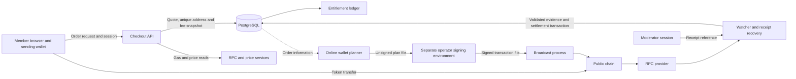

# cruush crypto processor threat model

Version 1.0, 2026-09-08. Status: proposed model for independent security review, not a security certification or launch approval.

## Scope and baseline

This model describes the processor source in `security/crypto-processor-review-20260908`: authenticated orders, deterministic receiving addresses, chain observation, settlement, purchased entitlements, support recovery, mandatory collection fees and the separate operator wallet. It includes the browser, database, RPC and price-provider boundaries needed to understand those components. Other social features are outside scope except where authentication and entitlement services are shared.

Read [SECURITY_REVIEW.md](SECURITY_REVIEW.md) for verification evidence and release limitations. “Implemented” below means a control is present in the cited code. It does not mean the deployed environment, external provider or operator workstation has been independently verified.

## Security objectives

1. Grant purchased benefits only to the owning order after sufficient qualifying payment evidence, at most once per order.
2. Bind payment credit to the intended chain, allowlisted token contract, receiving address, amount and on-chain arrival window. A transaction hash alone is not proof of payment.
3. Keep recovery words and signing keys out of the server, browser, logs, support tools and agent sessions.
4. Prevent the online planner from silently changing what an operator signs or where collected funds go.
5. Keep an issued quote stable. Require its mandatory fee; a failed estimate must not become a free-fee order.
6. Preserve enough evidence to reconcile missed, late, wrong-rail, duplicated and reorganized payments without silently inventing a refund or entitlement policy.
7. Preserve payment/account privacy and detect availability failures before users lose a payable window or funds remain uncollected.

## Assets and trust assumptions

| Asset | Required property | Consequence of loss |
| --- | --- | --- |
| Recovery words, derived private keys, backup | Confidentiality and recoverability | Theft or permanent inability to spend deposited funds |
| Receiving extended public key and descriptor fingerprint | Integrity; restricted disclosure | Address substitution if changed; linkage of receiving addresses if disclosed |
| Stablecoin balances and native gas | Authorized movement and sufficient availability | Theft, stranded funds or repeated fee loss |
| Order/address/index mapping | Integrity and durability | Wrong credit, address reuse, lost attribution after restore |
| Transfers, cursors, timestamps and block identity | Integrity and completeness | Fraudulent or missed settlement |
| Entitlement and purchase ledgers | Exactly-once consistency | Free benefits, double grants or paid users denied access |
| Sessions and moderator authorization | Authenticity and least privilege | Account takeover, payment-record disclosure or recovery abuse |
| Quote and fee snapshots | Integrity and explicit denomination | Undercollection, overcharge, inconsistent display or accounting |
| Source, lockfiles, migrations and deployment configuration | Provenance and controlled change | All application-level safeguards can be bypassed |

The application trusts its host, database, authentication service, configured RPC responses and installed dependencies. It does not independently verify chain consensus. HTTPS authenticates the endpoint connection; it does not make a compromised RPC's chain history truthful. The ETH/USD feed is another external trust dependency. The operator environment must protect secrets independently of this application.

## Actors and boundaries

Potential adversaries include unauthenticated traffic generators, malicious members with valid sessions, compromised members, compromised moderators, dishonest or compromised RPC/price services, browser extensions or injected scripts, operator-host malware, malicious dependencies, privileged database administrators and mistaken or malicious deployers. Chain reorganization, provider outage, token issuer action, lost backups and operational mistakes can produce comparable failures without a malicious member.

The dashed planner input is an operational information handoff, not an implemented automatic database-to-signer service. The signer must distrust the unsigned file. An address/QR returned to a browser crosses a separate display trust boundary: backend correctness does not protect a payer using a compromised browser.

## Threat register

Priorities are qualitative review priorities, not measured probabilities. **Critical** means potential custody compromise or systemic payment forgery. **High** means substantial incorrect settlement, disclosure or service disruption. **Medium** means bounded operational or disclosure impact that still needs a response. Residual risks are not accepted merely because they are listed.

| ID / priority | Scenario and precondition | Implemented controls and source | Residual risk / required review |
| --- | --- | --- | --- |
| T01 Critical | Browser, frontend build or API is compromised and substitutes the payment destination. | Server derives receiving addresses from its descriptor; client consumes server quotes. `crypto-payments.ts`, `crypto-wallet.ts`. | A compromised trusted display or server can redirect new payments despite the server holding no spending key. Review deployment provenance, browser security and destination-change monitoring. |
| T02 High | Member alters price, product, owner or idempotency fields to obtain cheap/free benefits. | Authenticated active-account routes; server catalog prices; reservation input matching; owner-scoped loads/cancellation. `routes/crypto-payments.ts`, `crypto-payments.ts`. | Session theft and privileged database changes remain outside these checks. Test cross-account access and unexpected fields for each route. |
| T03 High | Concurrent requests reserve the last slot twice, reuse an address incorrectly or double-grant access. | User/advisory locks, database allocation and uniqueness, transactional claim/grant checks. `crypto-purchase-atomicity.test.ts`, `crypto-watcher.ts`, migrations 116–123. | Constraint drift, a bypassing writer or a faulty restore can defeat application assumptions. Rehearse upgrade and restore, including index/cursor state. |
| T04 Critical | Compromised RPC fabricates mutually consistent logs, receipts, timestamps and confirmations. | Chain-ID and receipt/block consistency checks, exact transfer matching. `crypto-chain-source.ts`, `crypto-watcher.ts`. | These checks cannot distinguish a coherent lie from that provider. Review independent provider/node validation and alerting; neither quorum validation nor light-client verification is claimed. |
| T05 High | Member presents a reverted, wrong-token, wrong-chain, old or unrelated transaction as payment. | Receipt success, intended rail/contract/recipient, watch origin, timestamp and confirmation rules; transfer deduplication. `crypto-watcher.ts`, `crypto-chain-source.ts`. | Supported nonqualifying evidence can require human handling. Do not turn a support exception into a manual grant without a separate authorized procedure. |
| T06 High | Chain reorganization reverses a transfer after access has been granted. | Per-rail confirmation floors, reorg handling and cross-process watcher coordination. `resolveSettlementPolicy`, watcher tests. | Block counts are not a guarantee of irreversible settlement. A post-grant reorg is still an operational loss scenario; finality policy needs independent approval. |
| T07 High | Purchaser sends only the base price and relies on legacy underpayment tolerance to avoid the new fee. | Fee-bearing metadata selects zero underpayment tolerance; reconciliation uses the same distinction. `crypto-watcher.ts`, `crypto-reconciliation.ts`. | Legacy quotes retain their older rules. Privileged metadata/ledger mutation can bypass these distinctions. |
| T08 High | Manipulated, stale or unavailable gas/price data creates excessive charges, underfunded collection or blocked checkout. | Chain identity, fresh block check through completion of price fetch, bounded gas estimates, integer rounding, fee cap and fail-closed errors. `crypto-collection-fee.ts`. | Price response has no consumed source timestamp. Current cap is 100000 cents. Gas allowances, quote duration, source independence and cap need operational/owner approval. |
| T09 High | Repeated legitimate-looking order requests exhaust RPC limits, database connections or reservations. | Authenticated creation rate limits, bounded open intents and request timeouts. `routes/crypto-payments.ts`, `crypto-payments.ts`. | Network fee requests occur while a database transaction holds locks. Distributed accounts/provider delays can still reduce capacity. Load-test and set operational budgets. |
| T10 Critical | Operator seed/backup or signing host is compromised. | Hidden prompts, backup verification, refusal of detected agent/remote/capturing sessions; server receives public descriptor only. `interactive.ts`, `wallet.ts`. | TTY/environment detection is a heuristic. Host malware, screen capture, memory access and dependency substitution are not prevented. Approve a separate custody procedure before meaningful funds. |
| T11 Critical | A non-hardened child private key leaks alongside the receiving parent extended public key. | Server does not receive child private keys; wallet path and descriptor checks are explicit. `constants.ts`, `wallet.ts`. | BIP-32 parent-key recovery makes the impact broader than that child. Never treat exporting one child private key as safely isolating one payment address. See the primary specification below. |
| T12 Critical | An attacker modifies an unsigned bundle, raw transaction, destination or contract before signing/broadcast. | Strict plan and signed-payload parsing, descriptor/address/chain/amount checks, recipient restrictions and operator confirmation. `signing.ts`, `wallet-rpc.ts`, `cli.ts`. | A compromised signer can defeat software checks. Review both parsed intent and actual signed transaction validation; protect signed files because they authorize broadcast. |
| T13 High | Funding succeeds but sweeping fails, and retry sends unnecessary gas or spends with stale nonces. | Receipt-aware retry checks existing sweep first, then funding, before sending; chain check and deterministic transaction hashes. `broadcastSignedWalletSweepBundle`. | A single provider's receipt, nonce competition, replacements and a later reorg remain hazards. Re-plan deliberately; a receipt status is not an independent finality guarantee. |
| T14 High | Gas spikes, treasury gas depletion or token restrictions strand funds in derived addresses. | Planner balance checks and fee reserves; mandatory collection estimate recovers cost in stablecoin. `wallet-rpc.ts`, `crypto-collection-fee.ts`. | Stablecoin receipts do not replenish ETH automatically. Estimate differs from eventual actual cost; issuer restrictions and chain outages remain external dependencies. Set monitoring and collection responsibility. |
| T15 High | Compromised moderator account enumerates payment histories or submits misleading recovery evidence. | Moderator authorization; recovery rate limit; receipt ingestion revalidates chain evidence before settlement. `routes/crypto-payments.ts`. | Moderator access exposes sensitive linkage. No dual approval or independently verified immutable audit store is claimed. Review role provisioning, logging, export limits and incident response. |
| T16 High | Payment history or xpub leakage links membership to public wallet activity. | Member ownership checks and moderator-only support access; public-only descriptor avoids direct spending authority. | Unique addresses are for attribution, not anonymity. An xpub, database, logs or repeated treasury sweeps may expose linkage. Review retention, log redaction and access controls. |
| T17 Critical | Deployment activates testnet acceptance or uses a wrong descriptor/token configuration. | Processor/watcher default off; production configuration rejects the testnet flag; rail constants and chain checks. `config.ts`, `crypto-watcher-runtime.ts`. | Mislabeling the deployment environment, bypassing config loading or modifying code can evade those checks. Verify deployed identity and explicit activation approval. |
| T18 High | Database loss or rollback erases evidence or reuses an allocated child address. | Persistent order/index/transfer/cursor state and transactions. `crypto-payments.ts`, schema 116–124. | This is not a tested disaster-recovery system. Restore must preserve high-water marks and replay evidence before resuming issuance. An ordinary backup success is insufficient proof. |
| T19 Critical | Malicious dependency, build step or release artifact changes signer or evidence validation. | Versioned source and lockfiles; focused tests. | Tests are not supply-chain attestation. Fresh installation, dependency review, release provenance and isolated signer verification remain open. |

## Important qualifications

The receive-chain xpub alone does not authorize spending, but BIP-32 warns that combining a parent extended public key with a corresponding non-hardened child private key can reveal the parent private key. This makes child-key handling a custody-wide concern. [BIP-32, security implications](https://github.com/bitcoin/bips/blob/master/bip-0032.mediawiki#implications).

Base fee budgeting includes more than execution gas. OP Stack documentation describes execution, Layer 1 data and operator-fee components; the implementation uses an estimate/reserve, not an enforceable cap on every future network charge. [OP Stack transaction fees](https://docs.optimism.io/op-stack/transactions/fees).

Support recovery can grant when valid evidence qualifies under settlement rules. It is not uniformly an evidence-only endpoint. Conversely, `acceptLatePayment` must not be read as permission to grant for a transfer mined after expiry: settlement filters qualifying transfers by on-chain timestamp. Review those SQL predicates together with the policy object.

## Validation plan and known evidence

Existing tests cover price tampering, ownership, idempotency, chain data validation, replay, reorg handling, signer input checks and concurrent grants. The recorded database rehearsal covers failed-fee rollback, restored quote stability, purchase-only underpayment, a later fee top-up and one grant under concurrent settlement. These tests use controlled chain evidence; they do not prove public-RPC honesty or host isolation.

Before launch, assign an owner and disposition to every Critical/High threat. In particular:

- Security/custody reviewer: T01, T04, T06, T10–T13, T15, T17 and T19. Produce an operator/key-compromise and signed-file handling assessment.
- Backend reviewer: T02–T09 and T18. Exercise adversarial route inputs, corrupted evidence, concurrent requests, delayed providers and restored state against a disposable database.
- Operations owner: T08–T09, T13–T14 and T17–T18. Demonstrate monitoring, provider outage handling, gas replenishment, release controls and restore/replay.
- Product/privacy owner: fee cap and variance, legacy tolerance, refund/late-payment handling, T15–T16 disclosure and retention. Decisions are not made by this document.

Outstanding demonstrations include the live fee-inclusive checkout-to-grant-and-sweep path, fresh-install migrations, mainnet custody, finality/reorg loss policy and signer isolation. Earlier successful testnet transfers do not close all these threats.

## Incident handling requirements

These are proposed response requirements, not implemented automation or authorization to move funds.

1. Preserve logs, order mappings, transaction hashes, source/build identity and affected configuration; do not delete evidence or expose secrets in a support ticket.
2. For suspected address/key substitution, stop new issuance and signing through an approved incident procedure. Previously published chain addresses remain payable; handle outstanding orders separately.
3. For RPC inconsistency or reorg, withhold new automatic grants until evidence is independently reconciled. Do not treat a browser notification or a single receipt as sufficient recovery proof.
4. For signer compromise, use a separately trusted custody environment and an owner-approved recovery plan. Never request the seed in chat or on the compromised host.
5. Reconcile payment and entitlement ledgers before resuming. Record unresolved balances, affected members and any authorized remedial action.
