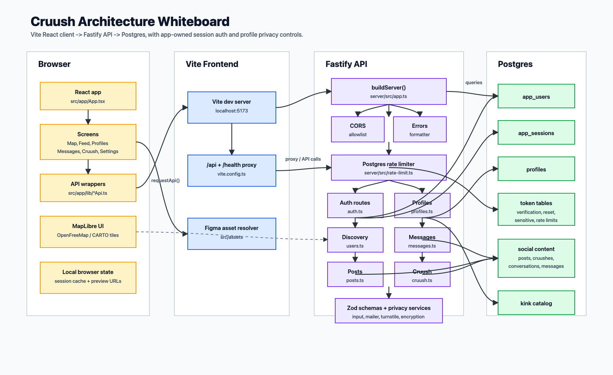
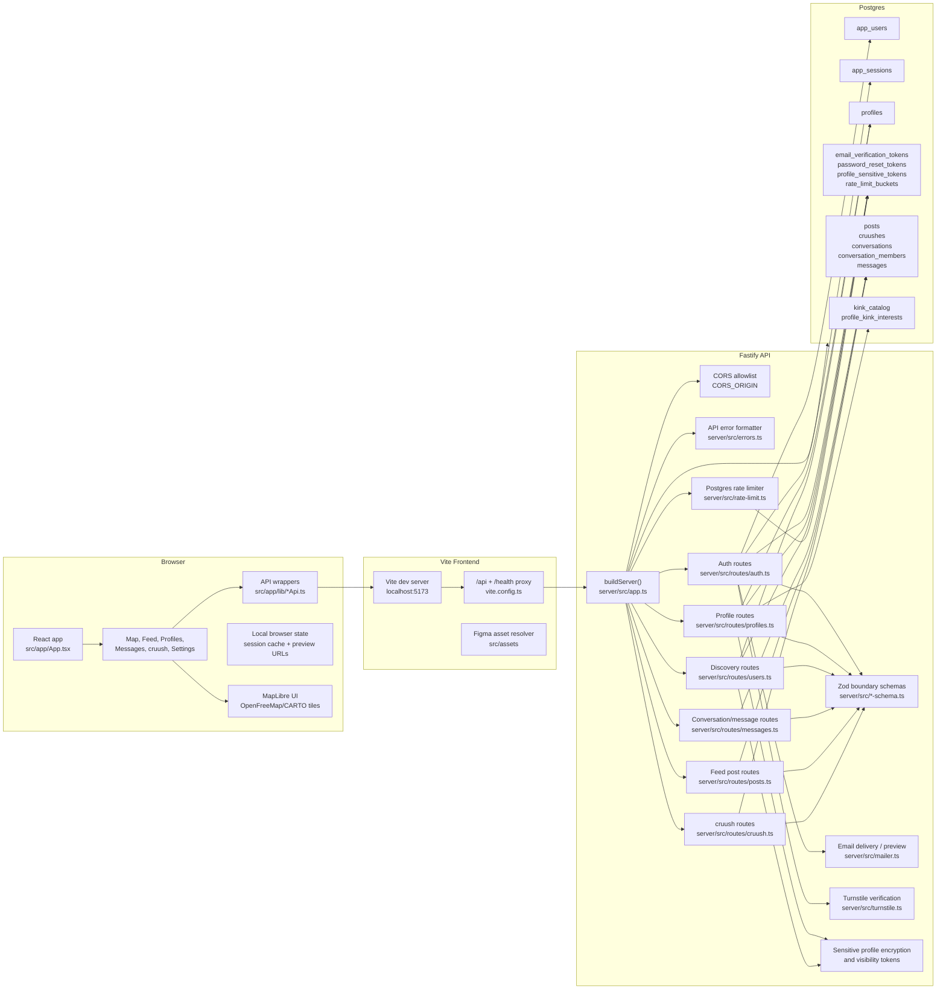
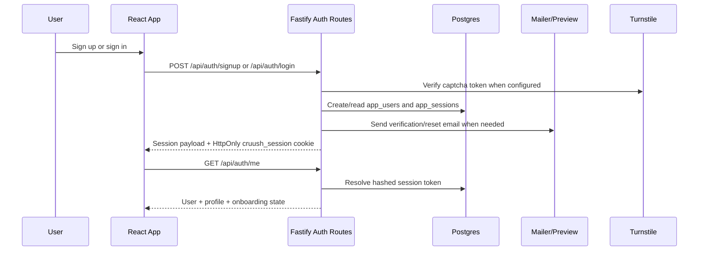
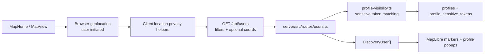
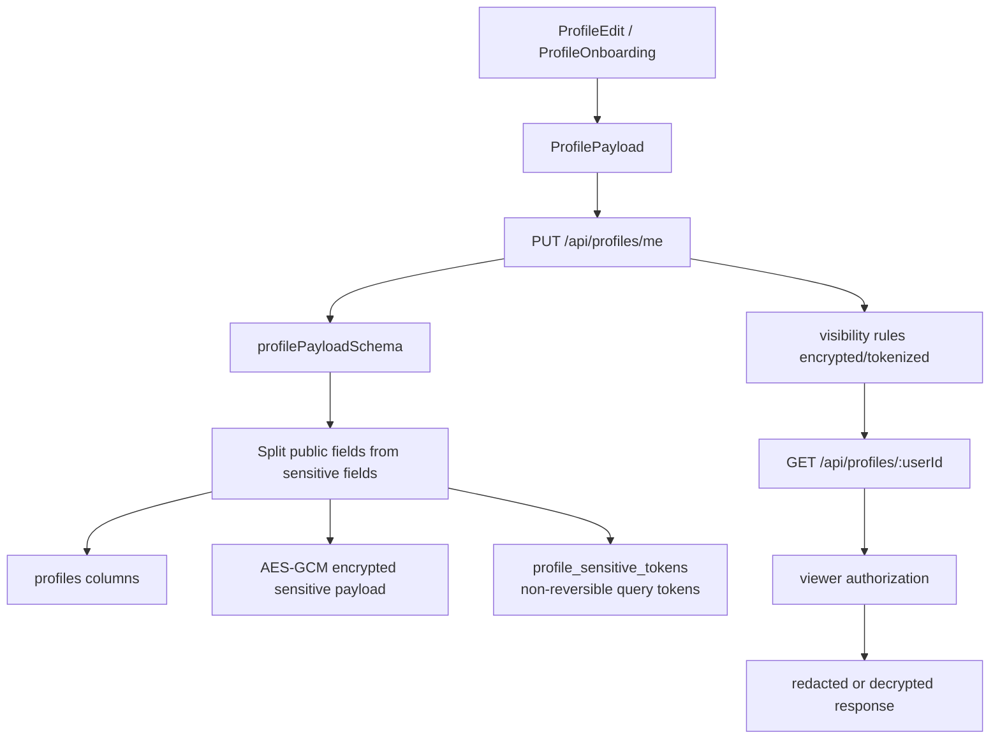
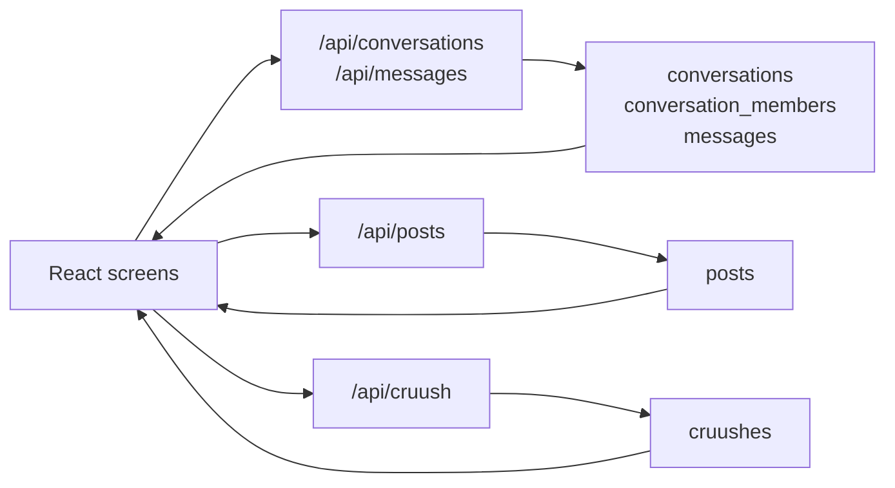
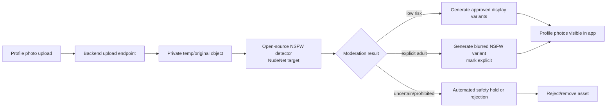
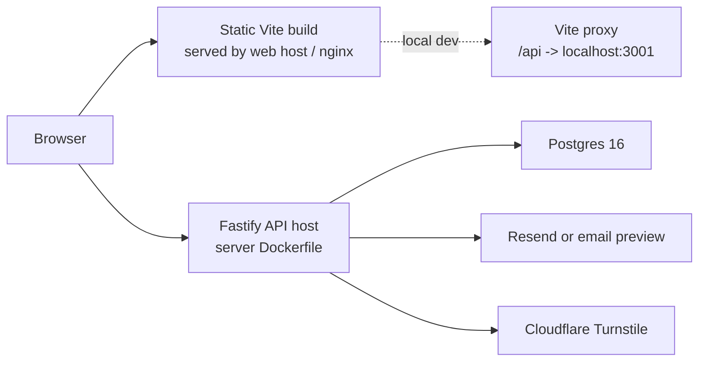

# cruush Architecture Whiteboard

This is a source-of-truth whiteboard for the current app shape. It reflects the Vite React client, the self-hosted Fastify API, and the Postgres-backed data model that replaced the older Supabase runtime path.

Rendered version of the main graph:

Editable SVG source: [architecture-whiteboard-main.svg](./architecture-whiteboard-main.svg)

## Runtime Shape

| Layer | Current implementation |
| --- | --- |
| Client shell | `src/main.tsx` mounts `src/app/App.tsx`; app routing is handled with `react-router`. |
| Primary UI routes | `/map`, `/feed`, `/profile`, `/profile/edit`, `/filters`, `/safety`, `/messages`, `/cruush`, `/settings`, `/lucky`, `/requests`. |
| API client | `src/app/lib/apiClient.ts` sends JSON requests with `credentials: 'include'`; feature-specific wrappers live in `src/app/lib/*Api.ts`. |
| Dev proxy | `vite.config.ts` forwards `/api` and `/health` to `http://127.0.0.1:3001`. |
| API server | `server/src/app.ts` builds a Fastify app, registers CORS, error handling, DB, rate limiter, and route modules. |
| Storage | Postgres via `server/src/db.ts`; schema migrations live in `server/sql/*.sql`. |
| Local stack | `npm run dev:local` runs migrations, API on `localhost:3001`, frontend on `localhost:5173`, and Postgres on `localhost:5432`. |

## Main Product Flows

### Auth And Session

Key files:

- `server/src/routes/auth.ts`
- `server/src/auth.ts`
- `server/src/auth-schema.ts`
- `src/app/lib/authApi.ts`
- `src/app/lib/sessionUser.ts`

### Map Discovery

The map does not own real-time presence. Nearby users come from the discovery API, with client-side controls for location sharing and server-side visibility checks.

Key files:

- `src/app/components/MapHome.tsx`
- `src/app/components/MapLibreMap.tsx`
- `src/app/lib/usersApi.ts`
- `src/app/lib/locationPrivacy.ts`
- `server/src/routes/users.ts`
- `server/src/profile-visibility.ts`

### Profiles, Privacy, And Sensitive Data

Sensitive profile fields are encrypted at the application layer when they do not need direct database filtering. Fields that need match/filter behavior use keyed token hashes instead of plaintext.

Key files:

- `server/src/routes/profiles.ts`
- `server/src/profile-schema.ts`
- `server/src/profile-sensitive.ts`
- `server/src/profile-visibility.ts`
- `docs/sensitive-data-encryption-plan.md`
- `docs/rotating-encrypted-token-system-white-paper.md`

### Messaging, Feed, And cruush Activity

Current social surfaces are request/response API workflows over Postgres tables. There is no WebSocket or background job layer in the checked-in runtime.

Key files:

- `server/src/routes/messages.ts`
- `server/src/routes/posts.ts`
- `server/src/routes/cruush.ts`
- `src/app/lib/messagesApi.ts`
- `src/app/lib/postApi.ts`
- `src/app/lib/cruushApi.ts`

### Photo Upload And NSFW Moderation Target

Photo moderation is not implemented in the checked-in runtime yet. The target is backend-side detection during upload, before a photo URL is written into `profiles.photos`. NudeNet is the preferred open-source detector because it can identify explicit body-part regions, which supports blur/reject/review flows better than a single safe/unsafe classifier.

Moderation policy target:

- Run detection server-side only; do not trust frontend moderation.
- Store originals privately and publish only approved/resized/blurred variants.
- Keep per-photo moderation metadata separate from the profile text model.
- Blur explicit photos by default unless the viewer enables explicit content.
- Use an automated fail-closed band for uncertain detector scores.
- Treat detector, Stream, and PhotoDNA output as automod signals, not a legal/compliance guarantee.

Suggested score bands:

| Detector score | Default action |
| --- | --- |
| `< 0.45` | allow after normal upload checks |
| `0.45 - 0.85` | block upload or retry automod; do not publish |
| `>= 0.85` | reject or apply feature/account enforcement depending on policy class |

Future key files:

- `server/src/routes/media.ts`
- `server/src/media-moderation.ts`
- `server/sql/018_media_assets.sql`
- `server/sql/019_media_moderation_events.sql`

## Boundary Rules

- API inputs should be parsed at the route boundary with Zod schemas from `server/src/*-schema.ts`.
- Route handlers should call `request.requireUser`-style session checks before user-owned reads or writes.
- The API emits formatted error bodies through `server/src/errors.ts`; the client turns those into `ApiClientError`.
- Rate limiting is app-injected and Postgres-backed through `server/src/rate-limit.ts` and `server/sql/017_rate_limit_buckets.sql`.
- Public frontend env vars are not secret. Backend-only secrets live in server env: `SESSION_SECRET`, `TURNSTILE_SECRET_KEY`, `PROFILE_ENCRYPTION_KEY`, `PROFILE_TOKEN_KEY`, `RESEND_API_KEY`.
- Future media moderation should run behind backend-only model/runtime configuration; no moderation bypass or detector keys should ship to the frontend.

## Deployment Sketch

The repo includes `Dockerfile`, `server/Dockerfile`, `nginx.conf`, and `docker-compose.selfhost.yml`. The current local/self-hosted target is intentionally small: static frontend, Fastify API, Postgres, optional mail/CAPTCHA integrations, and object storage later when photo upload moves off the current design/runtime path.
