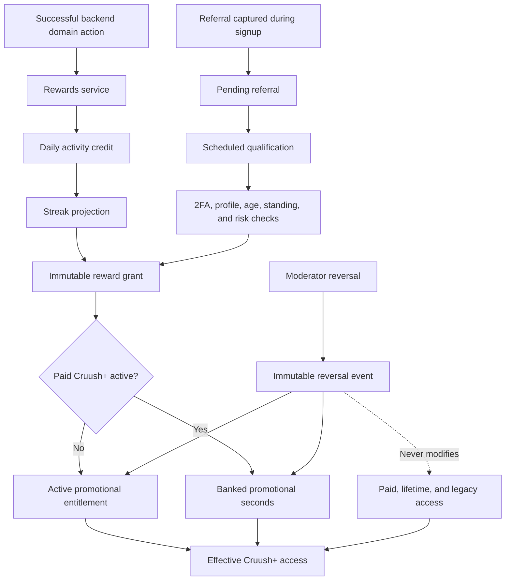

# Cruush rewards: implementation and design decisions

## Purpose

This document explains what changed to add Cruush rewards, why the system was
designed this way, which alternatives were avoided, and which decisions should
be revisited as Cruush grows.

For product rules, configuration, endpoints, and deployment procedures, see
[`rewards-system.md`](./rewards-system.md).

## Architectural context

The repository already used:

- a React/Vite PWA with React Router and the existing component library
- a Fastify TypeScript API
- PostgreSQL with numbered SQL migrations
- cookie-backed server sessions and internal password authentication
- existing paid, lifetime, and legacy Cruush+ entitlement sources
- an existing trust-event ledger, rate limiter, and notification system
- in-process API deployment without a separate job queue

The implementation extends those systems rather than adding a second
authentication provider, billing source of truth, frontend tracking pipeline,
or background-processing platform.

## Resulting architecture



| Area | Main implementation | Responsibility |
| --- | --- | --- |
| Schema | `server/sql/042_rewards_and_two_factor.sql` | Constraints, ledgers, referral/streak state, settings, and 2FA storage |
| Configuration | `server/src/reward-config.ts` | Validated defaults and cached database settings |
| Rewards | `server/src/rewards-service.ts` | Activity, streaks, grants, banking, summaries, and reversals |
| Referrals | `server/src/referrals-service.ts` | Capture, qualification, risk review, trust, and scheduling |
| Profile rules | `server/src/profile-completion.ts` | Reusable profile-completion decision |
| 2FA | `server/src/two-factor.ts` | TOTP, recovery, replay protection, and trust integration |
| API | `server/src/routes/rewards.ts` | Member and moderator endpoints |
| Frontend | `src/app/components/Rewards.tsx` | Rewards, referrals, history, and 2FA experience |

## Design decisions

### Reward only successful server-side domain actions

Activity is recorded from existing Cruush, message, and post routes after the
underlying action succeeds.

This proves that the user completed a real domain action and avoids spoofable
frontend activity beacons. Logins, app opens, reads, and polling do not count.
The database permits only one activity credit per user and local calendar date,
so sending more messages cannot produce more reward credit.

Reward recording is secondary to the social action: a temporary reward-service
failure is logged but does not undo a successfully sent message or Cruush.

### Store the calendar date and timezone used

`daily_activity_credits` stores both the resolved date and the timezone that
produced it. Calendar streaks therefore follow the user's configured timezone,
with UTC as the safe fallback.

Persisting both values makes past decisions reproducible for support and fraud
review. A later timezone change does not rewrite historical credits.

### Store durable activity facts and an efficient streak projection

Daily credits are the durable history. `user_activity_streaks` is the efficient
current projection.

Recomputing a user's full history on every action would become expensive, while
keeping the daily facts makes the projection inspectable and repairable. Row
locks serialize same-user streak updates, and unique milestone keys prevent a
repair or retry from granting a milestone twice.

### Use immutable grant and reversal ledgers

Every grant is appended to `reward_grants`. Fraud reversals are appended to
`reward_grant_reversals`; original grants are never edited or deleted.

A mutable `bonus_days` column could not explain where access came from or
support reliable reconciliation. The ledger records source, days, milestone or
referral, idempotency key, timestamps, status, and structured audit metadata.

Database uniqueness protects:

- each idempotency key
- each user/source/milestone combination
- one referral reward per referral

Application checks improve error handling, but the database remains the final
concurrency boundary.

### Keep promotional and paid Cruush+ independent

Promotional state lives in
`promotional_cruush_plus_entitlements`. Existing paid, lifetime, and legacy
sources remain unchanged.

This prevents reward code from fabricating payment-provider data, keeps revenue
and marketing access independently auditable, and ensures a fraud reversal can
remove only promotional access. Effective entitlement reads combine all valid
sources without changing their ownership.

### Bank exact promotional time during paid access

Promotional state contains an active expiry and banked seconds. Seconds were
chosen instead of an integer-day balance so starting a subscription halfway
through a promotional day does not discard the remaining hours.

New rewards are banked while paid access is active. Starting paid access moves
remaining active promotional time into the bank. After paid access ends, an
entitlement or rewards-summary read activates the bank transactionally.

### Serialize recipients before evaluating caps

The grant service locks the recipient user before calculating a rolling cap or
the maximum promotional bank.

Without one shared lock, two workers handling different milestones could both
observe available space and exceed the cap. Recipient serialization protects
aggregate limits, while unique idempotency constraints independently protect
individual rewards.

### Preserve audit identifiers after hard account deletion

Operational reward tables use normal user foreign keys. Immutable ledger user
and referral identifiers remain opaque UUIDs rather than cascading foreign
keys.

Cruush currently hard-deletes accounts. Cascading would erase audit history,
while restrictive foreign keys could block deletion. Opaque identifiers
preserve grant and reversal history without retaining a live user relationship.
A formal privacy-safe audit tombstone would be a useful future improvement.

### Capture referral ownership atomically during signup

The optional referral is inserted by the same signup SQL statement that creates
the account. Each referred account can have one referral, and a database trigger
prevents changing the referrer, referred account, or captured code.

This removes the reassignment and race conditions of a later "attach referral"
request. Database checks also reject self-referrals and duplicate referred
accounts.

The frontend keeps `?ref=` only in session storage until signup and does not
display it as user-facing state.

### Separate referral capture, qualification, and reward

The normal lifecycle is:

`pending -> qualified -> rewarded`

with `flagged`, `rejected`, and `reversed` review paths.

Account age cannot be established at signup, and 2FA, profile completion,
standing, or risk can change during the waiting period. The scheduled worker
therefore rechecks every condition immediately before granting.

If a cap or bank limit prevents issuance, the referral remains `qualified`
rather than receiving a partial reward. Only `rewarded` referrals appear as
successful to normal users.

### Flag suspicious growth instead of automatically rejecting it

The service checks referrer signup bursts, repeated existing HMAC
network/device signals when enabled, and account-review state.

Shared networks and legitimate viral growth can resemble fraud. Marking these
cases for moderator review avoids silent rewards without making brittle
automatic accusations. Existing hashed-signal infrastructure is reused; the
feature does not introduce raw IP retention or invasive fingerprinting.

Normal member responses never contain signal hashes, risk scores, review flags,
or internal fraud reasons.

### Reuse the existing trust ledger

2FA and referral trust changes use the existing trust-event service and trust
profile recalculation.

A separate rewards trust score would create conflicting sources of truth.
Idempotent trust events ensure disabling and re-enabling 2FA cannot repeatedly
award points. Referral-derived points are summed and capped independently by
event type.

### Implement internal TOTP because authentication is internal

No external authentication provider or MFA facility existed, so optional TOTP
uses the maintained `otplib` implementation.

Security choices include:

- AES-256-GCM encryption for TOTP secrets
- a dedicated `TWO_FACTOR_ENCRYPTION_KEY` when configured
- versioned encrypted records for future rotation
- current-password verification before setup
- a valid TOTP before activation
- scrypt-hashed, one-use recovery codes
- stored time steps to reject TOTP replay
- PostgreSQL-backed attempt limits
- password plus a fresh second factor for regeneration and disabling
- secret and QR display only during setup

`SESSION_SECRET` remains a compatibility fallback so a missing optional setting
does not crash an existing deployment. Production should use the dedicated key.

### Use validated database-backed settings

Reward settings are JSON values in `reward_settings`, validated centrally and
cached for 60 seconds per API process.

This avoids duplicated magic numbers and permits operational tuning without a
deployment. Missing or malformed settings fall back to documented defaults so
configuration mistakes do not take down social actions or authentication.

An administrative settings editor was deliberately deferred; controlled SQL is
the initial management surface.

### Use a small scheduler with a one-shot migration path

The API runs a bounded qualification pass every 15 minutes. The identical logic
is available through:

```sh
cd server
npm run rewards:qualify-referrals
```

This is the smallest reliable mechanism consistent with the current deployment.
Row locks and unique keys make repeated runs and multiple replicas safe. A
platform cron or dedicated worker can later invoke the one-shot command without
rewriting qualification logic.

### Centralize authorization and serialization

Member APIs expose only public streak, referral, promotional-access, rules, and
grant-history fields. Moderator APIs expose the audit details required for
investigation and reversal.

Central services keep route handlers thin and ensure synchronous requests,
scheduled jobs, and future administration tools use identical grant and
entitlement rules. Recovery hashes, encrypted secrets, fraud signals,
subscription internals, and private audit metadata never reach member clients.

### Encourage, but do not require, 2FA during onboarding

The primary onboarding completion action leads to the rewards and 2FA
experience. A visible "Skip 2FA for now" action still completes onboarding.

This reflects the product decision that 2FA materially improves account and
referral trust but is not required for general Cruush access. The UI does not
claim a reward before the backend confirms a ledger grant.

## Failure and retry behavior

| Situation | Result |
| --- | --- |
| A second meaningful action that day | No additional credit, streak, or reward |
| A milestone or job is retried | Unique keys prevent a duplicate grant |
| A reward hook fails after a social action | Social action remains successful; error is logged |
| Referral is too young or lacks 2FA/profile | Remains pending |
| Referred account is invalid | Rejected with a restricted audit reason |
| Referral looks suspicious | Flagged for review; no reward |
| Reward exceeds a cap or bank limit | No partial grant |
| Paid access is active | Promotional seconds are banked |
| A reversal is retried | Reports already reversed; no second subtraction |
| Settings are missing or malformed | Documented validated defaults are used |

## Testing strategy

Tests were added at multiple boundaries:

- reward service: calendar dates, reset behavior, milestones, caps, banking,
  expiry, retries, entitlement behavior, and reversals
- referral service: waiting periods, qualification gates, standing, suspicious
  growth, idempotent rewards, and trust points
- 2FA: setup, activation, invalid codes, replay, recovery, regeneration,
  disabling, and one-time trust
- routes: authentication, rate limits, and safe serialization
- frontend: loading, empty, success, error, referral copy, 2FA setup, and
  recovery-code states
- migrations: important constraints and immutable ledger behavior
- real PostgreSQL smoke checks: grant idempotency, activity crediting, summaries,
  referral identities, TOTP replay, and one-use recovery codes

## Alternatives deliberately avoided

| Alternative | Why it was rejected |
| --- | --- |
| Frontend activity tracking | Spoofable and rewards app opens rather than real actions |
| Editing payment-provider subscriptions | Mixes marketing rewards with billing and renewal behavior |
| One mutable promotional-days field | Cannot provide source, idempotency, reversal, or reconciliation history |
| Immediate referral rewards | Age, 2FA, profile quality, and standing are not established at signup |
| New device fingerprinting | Invasive and inconsistent with existing privacy infrastructure |
| New job-queue dependency | The deployment does not operate one; the one-shot worker preserves a future path |

## Decisions to revisit

Founders and operators should revisit:

1. Whether `post` should remain an eligible activity type.
2. Whether flagged referrals need a dedicated moderator dashboard.
3. Whether reward settings need an audited administrative editor.
4. When scheduling should move to platform cron or a dedicated worker.
5. Whether bank activation should also run proactively instead of on access
   reads.
6. Whether deleted-account ledger UUIDs need a formal audit tombstone.
7. Whether to enable a referral reward cap after observing actual growth and
   abuse patterns.
8. How encryption-key rotation will be operated before the first TOTP key
   change.

## Unrelated repository concerns

The rewards work does not modify moderation-media behavior. Dependency audits
still identify major-upgrade advisories in React Router and Sharp, plus a
development-only esbuild advisory. React Router and Sharp require separate,
carefully tested upgrades; Sharp participates in the existing media and
moderation path and was therefore not changed as part of rewards.

